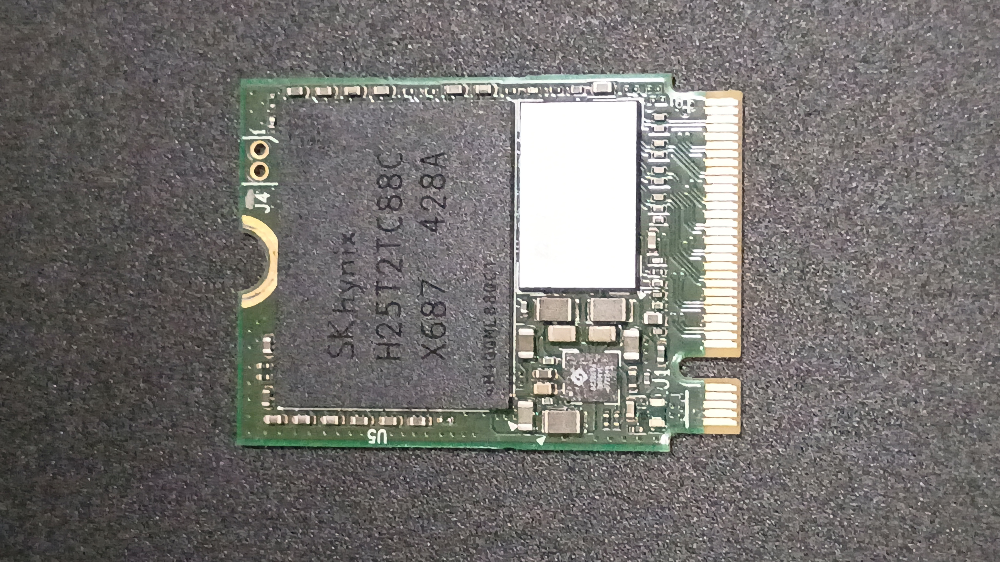
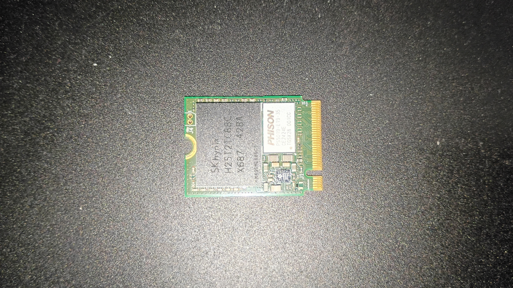
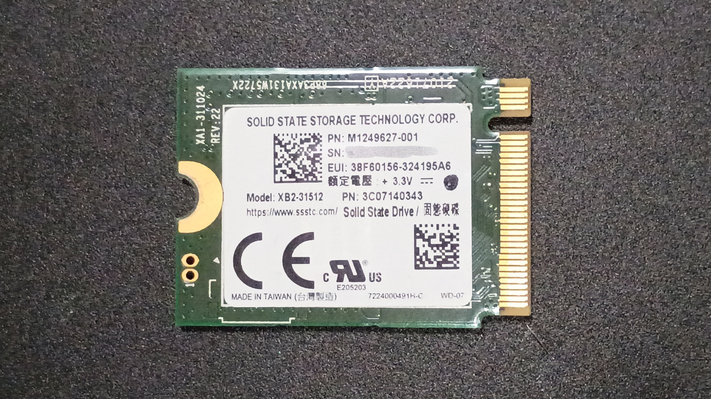
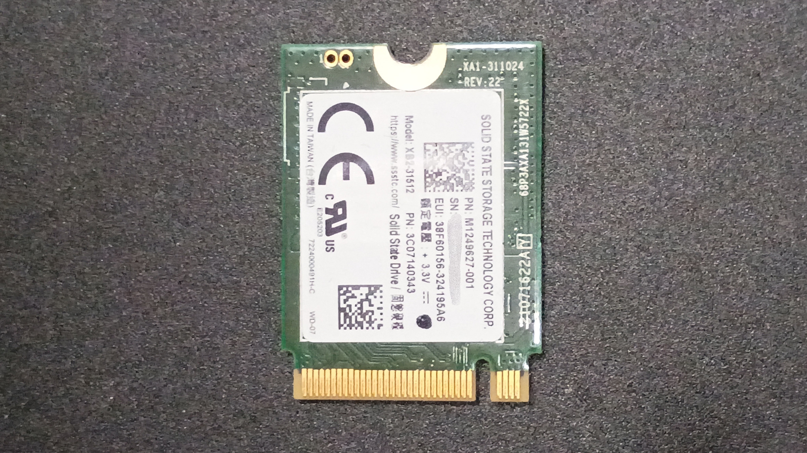

# Project Walrus
A research project attempting to document the Xbox Series S (2024, 512GB) SSD

Basic info:
- Model: SSSTC XB2-31512
- Firmware ver: 11.02.00
- Capacity: 512 GB (exposed capacity: 450.9 GB/420 GiB)
- NAND: SK hynix H25T2TC88C
- Controller: Phison PS5019-E19-35

## Photos
Reference photo, will be used throughout the readme

Additional photos

## J4
J4 is a 2-pin through-hole header on the top left edge, right next to the NAND.

When shorted, instead of booting into the retail firmware, it enters ROM mode. It will only boot into ROM mode if J4 is shorted.

When opened again, the SSD will boot into its normal firmware.

## Other shit I feel like dumping here

### Xbox SSD Naming Scheme

My guess as to how the SSDs are named.

<h2 align="center"><code>X[HV]-31[CAP]</code></h2>

| Component | Description |
|---|---|
| `X` | Product family prefix, X for Xbox |
| `HV` | Major hardware variant (`A1`, `B2`) |
| `31` | Not sure :D |
| `CAP` | Advertised capacity in GB (`512`, `1024`) |

**Known variants:**
- `A1` — Likely from earlier Xbox Series models (pre-2024)
- `B2` — Likely from newer Xbox series models (2024+)

### Inconsistent Identifiers

The SSD identifies itself differently depending on where you look (look at the naming scheme thing so you know what I'm talking about).
- Silkscreen reads XA1-311024 Rev 22, probably because SSSTC reused old PCBs. This was likely one of the last versions of XA1 before XB2.
- lspci in Linux identifies it as 1E95:100B, which is listed as "XB2-311024 NVMe SSD M.2 (DRAM-less)". This is only a 512 GB SSD though!
- nvme id ctrl returns "SSSTC XB2-31512". Now THIS is the only one you could trust, since this also appears on the sticker that they stuck to the back side