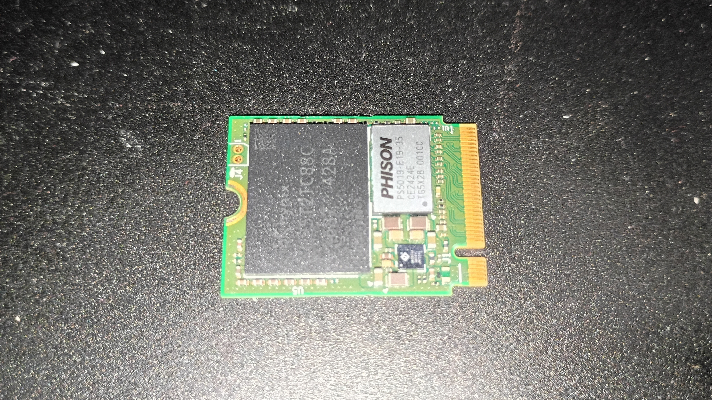
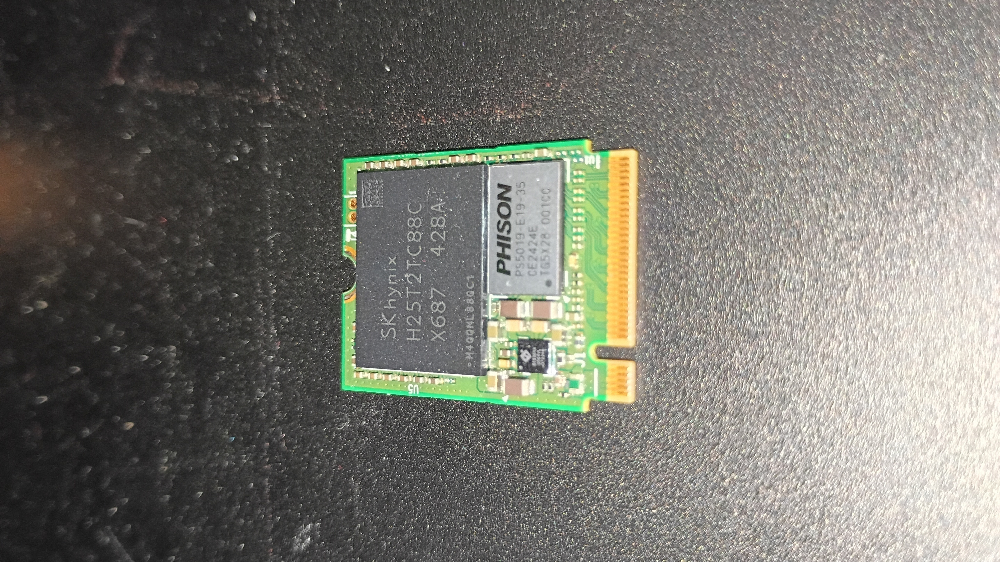
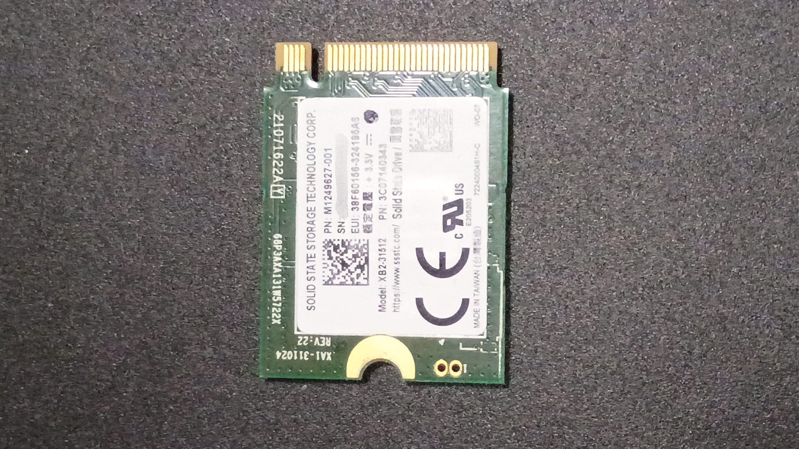

# Project Walrus
A research project attempting to document the Xbox Series S (2024, 512GB) SSD

Basic info:
- Model: SSSTC XB2-31512
- Firmware ver: 11.02.00
- Capacity: 512 GB (exposed capacity: 450.9 GB/420 GiB)
- NAND: SK hynix H25T2TC88C
- Controller: Phison PS5019-E19-35

## Photos

Reference

Additional photos

## J4
J4 is a 2-pin through-hole header on the top left edge, right next to the NAND.

When shorted, instead of booting into the retail firmware, it enters ROM mode. It will only boot into ROM mode if J4 is shorted.

When opened again, the SSD will boot into its normal firmware.